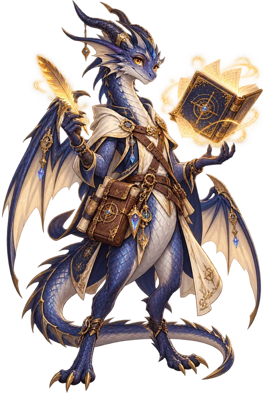
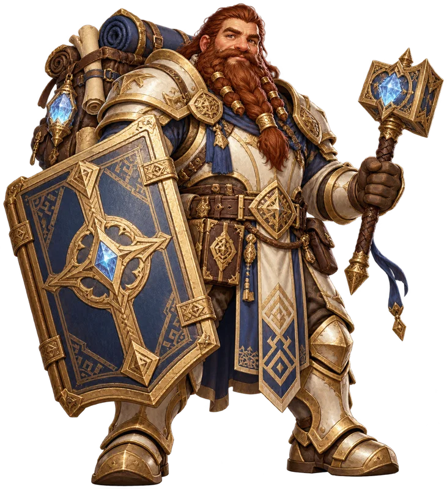
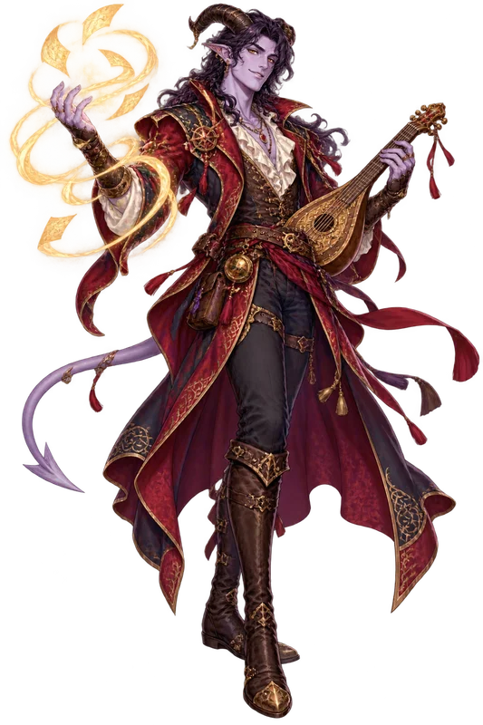

  

<strong>Turn every campaign into a living chronicle your whole party can revisit.</strong>

  <a href="https://github.com/mtamagno/questkeeper-rpg-campaign-manager/releases/latest"><strong>⬇️ Download QuestKeeper</strong></a>
  &nbsp;·&nbsp;
  <a href="https://mtamagno.github.io/questkeeper-rpg-campaign-manager/"><strong>⚔️ Live Companion</strong></a>
  &nbsp;·&nbsp;
  <a href="https://mtamagno.github.io/questkeeper-rpg-campaign-manager/manager-demo/"><strong>🗺️ Manager Demo</strong></a>
  &nbsp;·&nbsp;
  <a href="docs/INSTALLATION-GUIDE.md"><strong>🧭 Install</strong></a>
  &nbsp;·&nbsp;
  <a href="ROADMAP.md"><strong>✨ Roadmap</strong></a>
  &nbsp;·&nbsp;
  <a href="RELEASES.md"><strong>📖 Release Codex</strong></a>

  
  
  
  
  

QuestKeeper is a **self-hosted campaign home for tabletop RPG groups**. It
collects characters, NPCs, relationships, maps, artwork and session stories in
one polished website—while a friendly local Manager handles the files behind
the screen.

No subscription. No player accounts. No required AI. Your campaign remains a
portable folder you control.

◆ ───────────── ✦ ───────────── ◆

## One quest, two experiences

<table>
  <tr>
    <td width="50%" valign="top">
      
      <h3>For the party · Companion</h3>
      
Revisit the story, explore the cast, follow relationships, open private character sheets and remember what matters before the next session.

      
<strong><a href="docs/COMPANION-GUIDE.md">Explore the Companion guide →</a></strong>

    </td>
    <td width="50%" valign="top">
      
      <h3>For the GM · Manager</h3>
      
Create campaigns through guided forms, import characters, turn notes into editable drafts, preview changes and publish when they are ready.

      
<strong><a href="docs/MANAGER-GUIDE.md">Open the Manager guide →</a></strong>

    </td>
  </tr>
</table>

## What travels with your campaign

- Character and NPC profiles, private notes and level-by-level sheet history
- Session recaps, illustrated chapters, maps, locations and relationship webs
- Manual writing first, with optional local or explicitly configured remote AI
- Sheet-photo and shared Roll20 print-view imports that always produce editable drafts
- Discord Session Scribe or ordinary handwritten notes—the archive accepts both
- GitHub Pages publishing or direct FTPS from the Manager
- Any campaign language, with an English/Italian Manager interface

## Start in a few minutes

1. Download the **[latest release](https://github.com/mtamagno/questkeeper-rpg-campaign-manager/releases/latest)** or the **[current source ZIP](https://github.com/mtamagno/questkeeper-rpg-campaign-manager/archive/refs/heads/main.zip)** and extract its folder. The graphical bootstrap is on `main` now and enters packaged downloads with the next release; the immutable v1.0.0 archive keeps its original manual Node.js step.
2. On supported Windows packages, double-click `setup.bat`: the visual setup can install **Node.js 24**, prepare QuestKeeper and create desktop shortcuts for you.
3. On macOS open `setup.command`; on Linux run `./setup.sh`. Then follow the guided Manager, preview your Companion and publish when ready.

The Windows installer downloads Node.js only from `nodejs.org`, verifies its
official SHA-256 checksum and asks before changing the computer. It never
downloads an AI model without a separate choice. See the
**[Installation Guide](docs/INSTALLATION-GUIDE.md)** for the complete platform
walkthrough and troubleshooting.

◆ ───────────── ✦ ───────────── ◆

## Meet your guides

<table>
  <tr>
    <td width="25%" align="center" valign="bottom"></td>
    <td width="25%" align="center" valign="bottom"></td>
    <td width="25%" align="center" valign="bottom"></td>
    <td width="25%" align="center" valign="bottom"></td>
  </tr>
  <tr>
    <td align="center"><strong>Lyra</strong> <a href="docs/INSTALLATION-GUIDE.md">Installation</a></td>
    <td align="center"><strong>Quill</strong> <a href="docs/COMPANION-GUIDE.md">Reading & play</a></td>
    <td align="center"><strong>Brannik</strong> <a href="docs/MANAGER-GUIDE.md">Campaign Manager</a></td>
    <td align="center"><strong>Nyx</strong> <a href="docs/MANAGER-GUIDE.md#turn-notes-into-a-session">Stories & AI</a></td>
  </tr>
</table>

They are original QuestKeeper companions: a small high-fantasy party that
points readers toward the right guide without turning this page into a manual.

## Choose your path

| I want to…                                             | Read…                                                |
| ------------------------------------------------------ | ---------------------------------------------------- |
| Install, update or troubleshoot QuestKeeper            | **[Installation Guide](docs/INSTALLATION-GUIDE.md)** |
| Understand the player-facing campaign website          | **[Companion Guide](docs/COMPANION-GUIDE.md)**       |
| Create content, use optional AI, transcribe or publish | **[Manager Guide](docs/MANAGER-GUIDE.md)**           |
| Edit campaign JSON directly                            | [Content Guide](docs/CONTENT-GUIDE.md)               |
| See what comes next                                    | [Public Roadmap](ROADMAP.md)                         |
| Meet each version's fantasy companion                  | [Release Codex](RELEASES.md)                         |
| Contribute code or design                              | [Contributing](CONTRIBUTING.md)                      |

## Built for trust

QuestKeeper bundles no commercial rulebook text, published adventures or
third-party artwork. Use only material you wrote, created or are licensed to
redistribute. Remote AI and plain FTP are opt-in; generated content remains a
draft until the GM reviews and saves it.

<em>Keep the lore. Share the legend. Own the archive.</em>

  <a href="LICENSE">MIT License</a>
  &nbsp;·&nbsp;
  <a href="SECURITY.md">Security</a>
  &nbsp;·&nbsp;
  <a href="CONTRIBUTING.md">Contributing</a>

