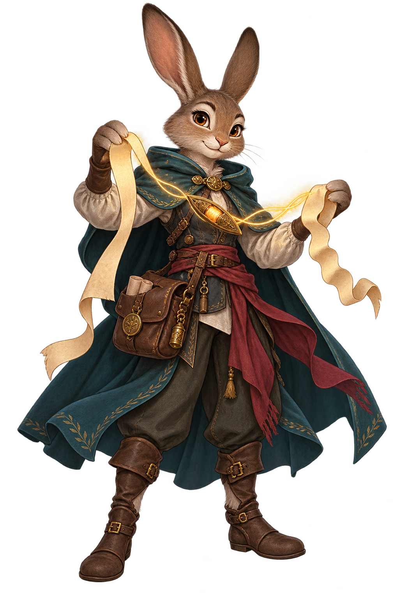

# The QuestKeeper Release Codex

> Every version opens a new chapter. Every chapter has a new companion.

[Download the latest release](https://github.com/mtamagno/questkeeper-rpg-campaign-manager/releases/latest)
· [Read the roadmap](ROADMAP.md) · [Learn how releases are made](docs/RELEASING.md)

QuestKeeper versions carry a short fantasy codename and an original companion
whose role reflects what that release adds to the table. The codename makes a
version memorable; the companion gives it a face without borrowing a character,
setting or visual identity from a commercial game.

---

## Current chapter

<table>
  <tr>
    <td width="38%" align="center" valign="middle">
      
    </td>
    <td width="62%" valign="middle">
      
<strong>QuestKeeper 1.1.4 · Seamkeep — LTS</strong>

      <h3>The Portable Thread</h3>
      
<strong>Mira Seamspell</strong> · harefolk path-binder

      <blockquote>“Every thread must hold on every road.”</blockquote>
      
Mira carries the Wayhold improvements through a native setup whose embedded runtime path holds across Windows, Linux and macOS checkouts.

      
<a href="docs/releases/v1.1.4.md"><strong>Read the release notes →</strong></a> · <a href="https://github.com/mtamagno/questkeeper-rpg-campaign-manager/releases/tag/v1.1.4"><strong>Download 1.1.4 LTS →</strong></a>

    </td>
  </tr>
</table>

> Tarn Evermark marks the immutable `v1.1.3` Wayhold packaging attempt. Its
> Windows gate failed before a GitHub Release was published, so Seamkeep
> supersedes it without rewriting the tag. Read the
> [LTS policy](docs/LTS-POLICY.md) for the maintenance promise.

---

## The release constellation

These names set the direction for the journey. A planned codename or companion
may move before its release branch opens if community feedback changes the
milestone; after publication, its identity is permanent.

| Version   | Codename          | Chapter                 | Release companion                              | Promise                                                            | Status                |
| --------- | ----------------- | ----------------------- | ---------------------------------------------- | ------------------------------------------------------------------ | --------------------- |
| **1.0.0** | **Starquill**     | The First Chronicle     | **Auri Starquill**, mothkin chronicler         | A campaign receives a beautiful, portable home.                    | Released              |
| **1.1.0** | **Lanternwake**   | The Welcoming Path      | **Fen Wickwhistle**, lantern-tailed pathfinder | Native guided setup reaches Windows, macOS and Linux.              | Released              |
| **1.1.1** | **Hearthkey**     | The Reopened Door       | **Twick Brasswhisker**, mousekin path-mender   | Windows shortcuts survive spaces in every local path.              | Released              |
| **1.1.2** | **Hearthrest**    | The Quiet Farewell      | **Vesper Hushwing**, owlkin night steward      | Setup closes cleanly instead of leaving a local process.           | Released              |
| **1.1.3** | **Wayhold**       | The Steady Chronicle    | **Tarn Evermark**, archive warden              | Feedback fixes, memory, access and speed become a dependable base. | Tag only · superseded |
| **1.1.4** | **Seamkeep**      | The Portable Thread     | **Mira Seamspell**, path-binder                | Native setup holds across every supported operating-system path.   | Released · LTS        |
| **1.2.0** | **Echobloom**     | Stories With Roots      | **Morrow Bellroot**, memory gardener           | Characters grow beyond a static sheet.                             | Planned               |
| **1.3.0** | **Moonmoot**      | Gather at the Table     | **Pip Hearthroll**, goblin table scout         | The party can prepare and catch up together.                       | Planned               |
| **1.4.0** | **Waywhisper**    | The Living Atlas        | **Orra Mosscompass**, centaur mapmaker         | People, places, clues and roads become connected.                  | Planned               |
| **1.5.0** | **Dragonbell**    | Game Night Edition      | **Vaela Emberchime**, drakekin herald          | QuestKeeper becomes the page opened during play.                   | Planned               |
| **2.0.0** | **Everchronicle** | The Party's Living Book | **Edda Runeheart**, archive guardian           | The complete campaign journey becomes one coherent home.           | Destination           |

Versions not yet listed receive a codename and companion before their release
candidate is tagged. Patch releases are included: their companion may be a
smaller familiar or specialist, but it must still be a new original character.

---

## The naming ritual

Every stable release follows this identity:

> **QuestKeeper X.Y.Z · Codename — Chapter title** 
> _Release companion · role_ 
> “One short line that captures the player-facing promise.”

- The codename is one short, pronounceable fantasy word, preferably an original
  compound such as _Starquill_ or _Lanternwake_.
- The chapter title explains the outcome in ordinary language; the codename
  supplies wonder, not ambiguity.
- Names never imitate a commercial tabletop setting, character or publisher.
- A published codename is never reused or reassigned.

## The companion oath

Every public tag introduces one new original release companion, including patch
versions. The character must:

- embody the release's main benefit through their role, prop and short quote;
- have a distinct name, silhouette and archetype from earlier companions;
- use QuestKeeper's clean, polished high-fantasy visual language while remaining
  readable on both light and dark GitHub surfaces;
- ship as a transparent WebP or PNG with meaningful alternative text;
- contain no logos, generated text, protected characters or copied franchise
  details;
- appear in this codex and in that version's release notes before tagging.

Guide companions such as Lyra, Quill, Brannik and Nyx teach stable parts of the
product. Release companions mark a moment in its history. The two casts may
meet in illustrations, but they never silently replace one another.

## What ships with a named release

- `docs/releases/vX.Y.Z.md` with codename, chapter title and companion block;
- `docs/images/releases/vX.Y.Z-<codename>-<name>.webp` (or `.png`);
- an entry in this codex with status and player-facing promise;
- verified ZIP, TAR.GZ and SHA-256 checksum artifacts;
- an immutable Git tag that matches the package version.

The automated release check enforces these essentials. The complete process is
documented in [Releasing QuestKeeper](docs/RELEASING.md).

---

<em>Keep the lore. Name the chapter. Meet its keeper.</em>

