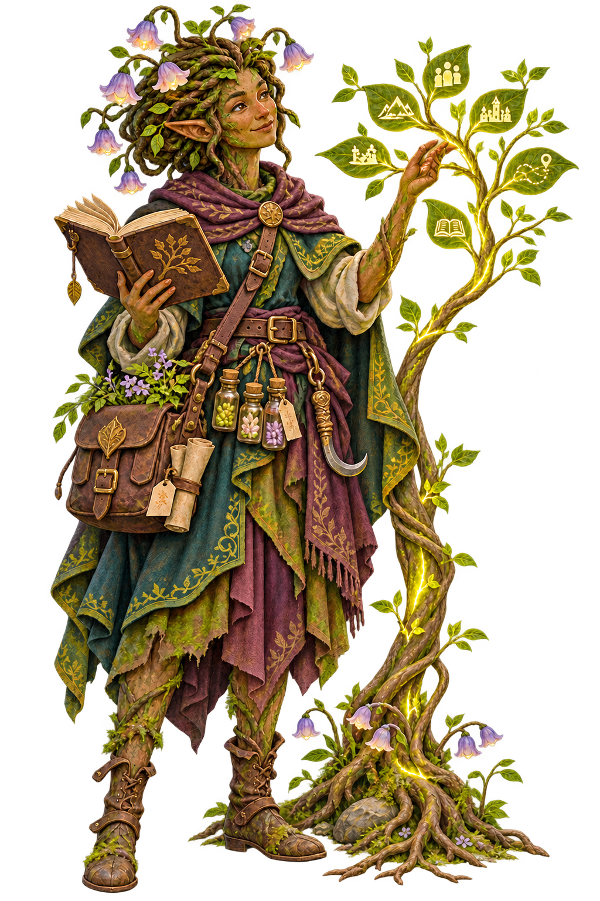

# QuestKeeper 1.2.0 · Echobloom — Stories With Roots (LTS)

**Release channel · LTS**

QuestKeeper 1.2.0 is the recommended stable release for long-running tables.
Echobloom connects the people, memories, languages and places of a campaign
without turning profiles or chronicles into endless pages.

<table>
  <tr>
    <td width="34%" align="center" valign="middle">
      
    </td>
    <td width="66%" valign="middle">
      <h3>Release companion · Morrow Bellroot</h3>
      
<em>Plantfolk memory gardener and tender of connected stories</em>

      <blockquote>“Let every memory take root where the whole party can find it.”</blockquote>
      
Morrow tends characters, relationships, languages, maps and illustrated memories as connected parts of one calm, readable campaign home.

    </td>
  </tr>
</table>

[Meet every release companion in the Release Codex](https://github.com/mtamagno/questkeeper-rpg-campaign-manager/blob/v1.2.0/RELEASES.md).

## Character stories without the wall of text

- Profiles open with a concise identity view and separate story, bond, sheet and
  journal workspaces without dropping any existing content.
- Character sheets use focused tabs for core statistics, combat, abilities,
  inventory and rules, with direct links and safe reading-position recovery.
- Protected long-form backstories and optional illustrated notebooks remain
  available without exposing private prose in public navigation or previews.
- Mobile navigation, command actions and reading surfaces now preserve touch
  targets, focus order and useful content width on narrow screens.

## Campaign-defined languages

- Each campaign owns an ordered registry of one or many languages, including
  source, default, direction and fallback behavior.
- Existing English/Italian campaigns migrate losslessly, while new campaigns
  are no longer restricted to those two languages.
- Manager authoring, Companion reading, search, offline output, PDF generation
  and manual or AI-assisted translation share the same locale contract.
- Interface language choices and reusable product copy come from versioned JSON
  catalogs instead of hard-coded TypeScript or template branches.

## A calmer campaign console

- User Settings now separates global preferences from campaign-specific choices
  in an RPG-style, keyboard-navigable console.
- “My Character”, audio, language and future player-owned preferences have one
  discoverable home instead of competing for permanent toolbar space.
- The responsive command bar keeps frequent actions visible, moves secondary
  actions into a labelled overflow and restores focus after dismissal.

## Maps and illustrated memories

- The atlas adds localized search, exploration filters and previous/next place
  navigation while preserving campaign-owned map and location content.
- Gallery collections are compact, counted and collapsible, so long campaigns
  remain scannable as their image libraries grow.
- Lightboxes expose loading, failure and retry states and correctly expand small
  or vector artwork without navigating away from the current reading position.
- NPC, relationship, chronicle, map and gallery interface copy now follows the
  same editable JSON catalog boundary as the rest of the Companion.

## Compatibility and safety

- The public example, completed Phandelver campaign and active Curse of Strahd
  campaign pass the same locale, accessibility, entity-ID, build and performance
  contracts without moving private campaign content into this repository.
- Campaign canon, protected notes, transcripts, credentials and licensed media
  remain outside the release archive.
- Node.js 26 remains the supported runtime for source launchers, CI and native
  setup packages on Windows, Linux and Intel/Apple Silicon macOS.

## Resolved field feedback

Echobloom contains the released implementations for configurable campaign
languages (#112 and #115–#118), legacy locale recovery (#133), aligned menu and
content reading (#135), and JSON-owned chronicle, NPC, relationship, atlas and
gallery copy (#140). Each issue closes only after the published artifacts and
hosted demo complete their smoke checks.

## Upgrading from 1.1.5

Run the guided setup over the existing installation. QuestKeeper preserves
campaign-owned data and creates a recoverable backup before applying locale
metadata or storage migrations. Legacy bilingual campaigns remain readable
during the transition; no translation is invented for an empty locale.

## Download

Choose `questkeeper-v1.2.0-windows-x64.zip` for Windows. Linux x64, macOS Intel
and macOS Apple Silicon archives are built from the same tagged source. Verify
the selected archive against `SHA256SUMS.txt` before opening it.

Read the [Installation Guide](https://github.com/mtamagno/questkeeper-rpg-campaign-manager/blob/v1.2.0/docs/INSTALLATION-GUIDE.md) for the guided setup and migration flow.

**Keep the roots. Follow the branches. Let every story bloom.**
